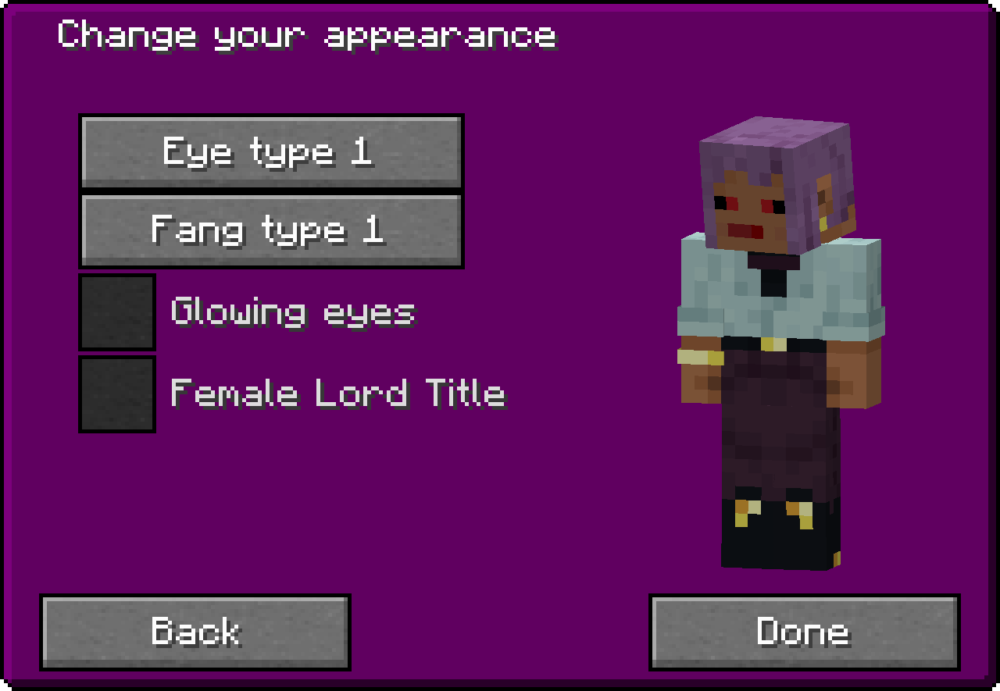
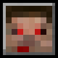

You can configure the appearance of your vampire player model in the Vampire Appearance Screen or by commands.

You can configure the following:
- Eye type and position (face editor)
- Fang type and position (face editor)
- Glowing eyes
- Lord title gender (female titles)
- Wings type (only Dracula)

## Appearance Screen

It can be opened from the Vampirism Menu by clicking this button:

The screen contains
- **Edit Face**: the face editor. Switch between *Eyes* and *Fangs*, choose a type from the list (hover to preview, there is also an option for no eyes / no fangs), and click or drag on the face grid to place them. A checkbox toggles *Glowing Eyes*.
- **Female Lord Title**: use the female forms of your lord title. Hover the checkbox to see the list of titles.
- **Wings**: a dropdown to choose the wings type. Only shown to players with the Dracula rank.

## Wings
Players with the Dracula rank have wings. Toggle them with the "Toggle Wings" key (default `,`, configurable in the Vampirism key bindings). They cannot be opened while in a form like bat form or mist.

## Commands
The appearance commands are grouped under `/vampirism appearance`:
- `/vampirism appearance eye <0-16>`
- `/vampirism appearance fang <0-6>`
- `/vampirism appearance glowingEye <true|false>`

These commands are marked as deprecated in the code, the Appearance Screen is the intended way. The old `/vampirism eye` and `/vampirism fang` forms do not exist anymore.
The lord title gender is changed in the Appearance Screen.
